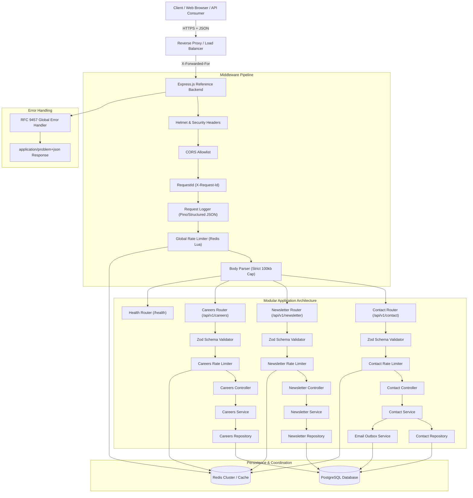
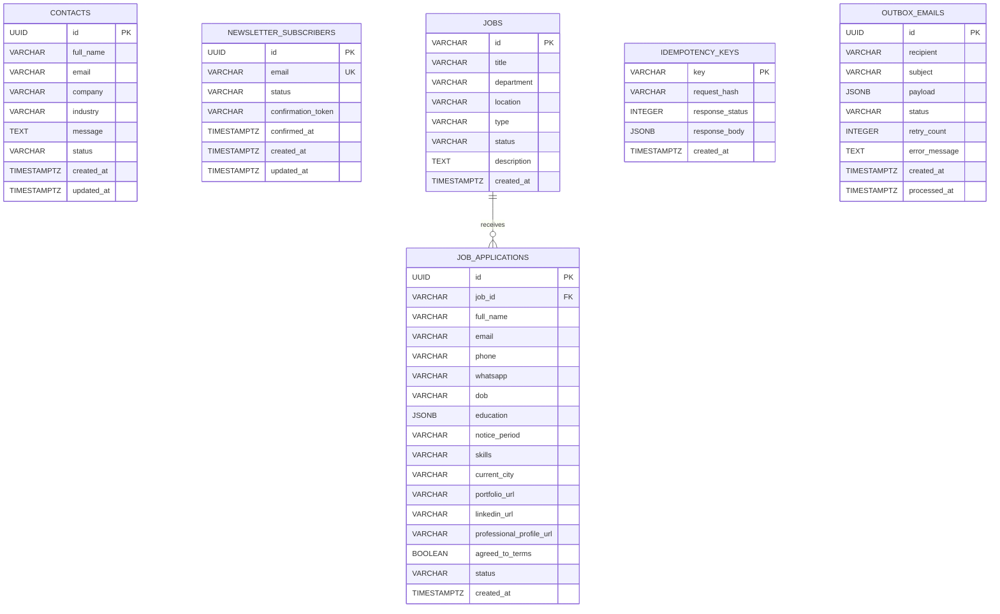

# Backend Reference Implementation Architecture

**System:** Cynbit Backend Reference Implementation  
**Architecture Style:** Clean Architecture / Layered Modular Monolith  
**Runtime:** Node.js v22 (ESM) + Express.js + TypeScript  
**Persistent Storage:** PostgreSQL (connection pooling via `pg.Pool`)  
**Cache & State Layer:** Redis v7 (`ioredis` with Lua scripting)  
**Contract & Validation:** Zod + RFC 9457 Problem Details  

---

## 1. High-Level Architectural Diagram



---

## 2. Separation of Concerns & Clean Architecture

The implementation enforces a strict 4-tier layered architecture:

1. **Routing Layer (`src/routes/`)**:
   Defines URL paths, binds endpoint-specific rate limiters, mounts validation middleware, and dispatches to controllers.
2. **Controller Layer (`src/modules/*/*.controller.ts`)**:
   Responsible solely for HTTP transport concerns: parsing request headers (such as `Idempotency-Key` or `X-Request-Id`), calling domain services, and returning standardized API envelopes (`200 OK`, `201 Created`, `202 Accepted`).
3. **Domain Service Layer (`src/modules/*/*.service.ts`)**:
   Contains pure business logic, orchestration of transactional outbox records, duplicate detection algorithms, payload hashing, and domain exception handling (`AppError`, `ConflictError`, `NotFoundError`).
4. **Data Repository Layer (`src/modules/*/*.repository.ts`)**:
   Executes parameterized SQL queries against PostgreSQL. Contains zero HTTP or routing logic. Encapsulates all SQL syntax and mapping to strongly typed entity records.

---

## 3. Distributed Sliding-Window Rate Limiter Design

To address **Issue 1** without relying on single-process memory maps, the rate limiter uses a distributed sliding window implemented in Redis using sorted sets (`ZSET`) executed via an atomic Lua script.

### 3.1 Rate Limit Formula & Storage
* **Key Format**: `cynbit:ratelimit:{policy}:{client_ip}`
* **Score**: Unix timestamp in milliseconds (`now = Date.now()`)
* **Value**: Unique string `${now}:${uuid}`

### 3.2 Atomic Lua Script Algorithm
```lua
local key = KEYS[1]
local now = tonumber(ARGV[1])
local windowMs = tonumber(ARGV[2])
local maxRequests = tonumber(ARGV[3])
local uniqueMember = ARGV[4]

-- 1. Evict entries outside the sliding window
local clearBefore = now - windowMs
redis.call('ZREMRANGEBYSCORE', key, '-inf', clearBefore)

-- 2. Measure active requests in current window
local currentRequests = redis.call('ZCARD', key)

if currentRequests < maxRequests then
    -- Under limit: add current timestamp and refresh TTL
    redis.call('ZADD', key, now, uniqueMember)
    redis.call('PEXPIRE', key, windowMs + 1000)
    return {1, maxRequests - currentRequests - 1, 0}
else
    -- Over limit: compute exact retryAfter based on oldest timestamp
    local oldest = redis.call('ZRANGE', key, 0, 0, 'WITHSCORES')
    local retryAfterMs = (tonumber(oldest[2]) + windowMs) - now
    return {0, 0, math.ceil(retryAfterMs / 1000)}
end
```

### 3.3 High-Availability & Degraded Mode Fallback
If Redis encounters network partitions, crashes, or timeout events:
* The system logs a warning and dynamically transitions to a local in-memory sliding window algorithm.
* Protects against server crashes while preventing total denial of service for legitimate users.

---

## 4. RFC 9457 Problem Details for Error Handling

To permanently eliminate the vague error feedback documented in **Issue 3**, all API errors follow the **IETF RFC 9457 (formerly RFC 7807)** specification:

### Standard Error Schema
```json
{
  "type": "https://api.cynbit.in/errors/validation-error",
  "title": "Validation Error",
  "status": 400,
  "detail": "Request validation failed. Please check field-level errors.",
  "instance": "/api/v1/careers/applications",
  "requestId": "req_8a9b2c3d4e5f",
  "timestamp": "2026-10-30T06:50:00.000Z",
  "errors": [
    {
      "field": "portfolioUrl",
      "message": "Please enter a valid URL, such as https://drive.google.com/file/d/... or https://alex.dev"
    }
  ]
}
```

### Error Taxonomy
* `https://api.cynbit.in/errors/validation-error` (HTTP 400) - Field-level schema violations.
* `https://api.cynbit.in/errors/rate-limit-exceeded` (HTTP 429) - Sliding window quota breached.
* `https://api.cynbit.in/errors/conflict` (HTTP 409) - Duplicate application or conflicting idempotency key.
* `https://api.cynbit.in/errors/not-found` (HTTP 404) - Resource not found.
* `https://api.cynbit.in/errors/internal-error` (HTTP 500) - Sanitized internal server failure.

---

## 5. Idempotency Key Specification

To resolve the duplicate submission vulnerability highlighted in **Issue 4**:
1. Clients can supply a standard header: `Idempotency-Key: <unique-uuid>`.
2. The service generates a SHA-256 hash of the request payload:
   $$\text{hash} = \text{SHA256}(\text{JSON}(\text{body}))$$
3. Looks up `key` in `idempotency_keys` table:
   * **Matching Key + Matching Hash**: Replays original response status (e.g. `202 Accepted`) and body with `meta.isIdempotentReplay: true`. Zero duplicate database records or emails created.
   * **Matching Key + Conflicting Hash**: Rejects with `HTTP 409 Conflict` (`Idempotency-Key reuse with conflicting request payload`).
   * **New Key**: Processes request normally, persisting the result to `idempotency_keys`.

---

## 6. Asynchronous Notification Outbox Architecture

Addressing the false delivery guarantee issue:
* Web requests do not directly execute slow or unreliable third-party SMTP calls.
* Instead, the service transactionally persists an email job into the `outbox_emails` table with `status = 'QUEUED'`.
* The HTTP response immediately returns `HTTP 202 Accepted` with a tracking reference.
* An asynchronous background worker picks up queued jobs, executes them with exponential backoff retries (up to 3 attempts), and updates status to `'SENT'` or `'FAILED'`.

---

## 7. Database Relational Model


